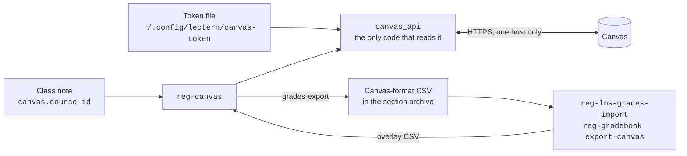
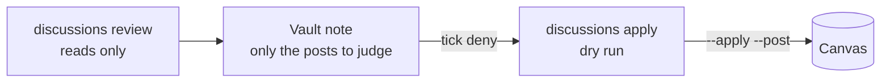

# Using the Canvas API with `reg-canvas`

**Time:** about 15 minutes to set up, once per token. After that, each command takes seconds.

`reg-canvas` replaces the copy-and-paste steps between your course records and
Canvas. It exports the gradebook, pushes grades back, checks the roster, and
posts announcements, discussions, assignments and the syllabus. It also audits
the gradebook and grades discussion assignments.

> [!CAUTION]
> **Every write is a dry run until you add `--apply`.** A dry run shows exactly
> what would change and sends nothing. Read it before you apply, because an
> announcement notifies students the moment it posts and a grade is visible as
> soon as it is posted.

## 1. How the pieces fit



| Piece | What it is | Who touches it |
|---|---|---|
| The token | A personal access token. It acts as you, with all your Canvas permissions. | You, once: store it, and renew it before it expires. |
| `canvas_api` | The client module. It is the only code that reads the token. | Nobody edits it day to day. |
| The class note's `canvas:` block | Links one section to its Canvas course ID. | `reg-canvas courses --bind`, once per term. |
| `reg-canvas` | The commands. Each one finds its course through the class note. | You, or an AI agent working for you. |
| The export CSV | The gradebook in the same layout as Canvas's *Export* button. | The existing grade tools read it unchanged. |

> [!IMPORTANT]
> **A common misconception is that a token can be limited to reading.** It
> cannot. A Canvas user token carries every permission your account has, in
> every course you teach. Lectern compensates in three ways: the token never
> leaves one file, it is sent to only one host, and every write is a dry run
> until you say otherwise.

## 2. Get a token

Many institutions, CSULB among them, do not let instructors create tokens
themselves. Ask your campus Canvas administrators for one. Two things to know:

- **It must be activated.** An administrator can create the token, but it
  stays inactive until you open Canvas → **Account → Settings** and activate
  it. Until then every call returns `HTTP 401`.
- **It expires.** Instructure limits tokens to 90 days. Ask for a new one
  before the old one expires.

## 3. Store the token

```sh
mkdir -p ~/.config/lectern && chmod 700 ~/.config/lectern
( umask 077; read -rsp "Canvas token: " t; echo; printf '%s\n' "$t" > ~/.config/lectern/canvas-token )
reg-canvas whoami
```

`read -rs` keeps the token off the screen and out of your shell history. If the
token works, `whoami` prints your Canvas name.

> [!WARNING]
> Never put the token in a repository, a notes vault, a command line or an
> environment variable. Lectern reads it only from the file. It refuses to
> start if anyone but you can read that file.

To use a Canvas host other than CSULB's, set it in `~/.config/lectern/config.toml`:

```toml
[canvas]
base_url = "https://canvas.example.edu"
```

If you use an AI coding assistant, block it from reading the token file. In
Claude Code, add deny rules to `~/.claude/settings.json`:

```json
"permissions": { "deny": ["Read(~/.config/lectern/canvas-token)",
                          "Edit(~/.config/lectern/canvas-token)"] }
```

## 4. Link each section to its Canvas course

Run this once per term:

```sh
reg-canvas courses                                   # list your courses
reg-canvas courses --bind --term fa26 --vault-root <V>
```

`--bind` matches each section to its course by course number, section and
class number. It then writes the course ID into the class note:

```yaml
canvas:
  course-id: 123142
  url: https://csulb.instructure.com/courses/123142
```

Class numbers can repeat across years. When more than one course matches, the
Canvas term name (for example `Fall 2026`) decides. If the match is still not
clear, the command stops and lists the candidates, and you can write the block
by hand.

To test against another course, such as your sandbox, pass `--course-id <id>`
in place of `--term`.

## 5. Commands that only read

| Command | What it does |
|---|---|
| `whoami` | Checks the token. |
| `courses` | Lists your courses. `--bind` links them to class notes. |
| `grades-export` | Writes the gradebook as the CSV Canvas's *Export* button produces. |
| `roster-check` | Compares Canvas enrolments with the registrar roster. |
| `audit` | Finds work that was never graded or never posted, and settings that skew the weighted score. |

### Export the gradebook

```sh
reg-canvas grades-export --term fa26 --vault-root <V> --import
```

Each section's export goes to
`classes/<course>/archives/<term>-<section>/canvas/<timestamp>_Grades-CECS_326_Sec01.csv`.
`--import` then runs `reg-lms-grades-import` into that archive's `grades.csv`. If course staff, such as a grad assistant, hold a student enrolment, add `--exclude-sis <id> ...` so they are filtered out with reason `staff`.
Without `--import`, the command prints the import command to run next.

The layout matches Canvas's own export, with two differences:

- **No per-group subtotals.** The API does not return columns such as "Class
  Participation Current Score". No lectern tool reads them.
- **Active students only.** Add `--include-inactive` for concluded and
  inactive enrolments.

### Check the roster at census

```sh
reg-canvas roster-check --term fa26 --vault-root <V> \
    --roster '<V>/classes/326/archives/fa26-{section}/roster.csv'
```

The roster is a `reg-lms-roster-import` CSV, and `{section}` expands for each
section. The command lists every student found in only one of the two sources:

- **In Canvas only:** often a dropped student still in the course shell.
- **In the roster only:** often a late add that has not reached Canvas yet.

It exits with status 1 when the sources disagree, so a script can check it.

## 6. Commands that write

All of these are dry runs until you add `--apply`.

| Command | What it creates or changes | Default |
|---|---|---|
| `grades-push` | Grades, from a Canvas-format import CSV | Changed cells only |
| `announce` | An announcement | Posts at once (use `--delay-until` to schedule) |
| `discussion` | A discussion topic | Unpublished |
| `assignment` | An assignment | Unpublished, submission type `none` |
| `syllabus` | The course syllabus page | Refuses a file without its serial |
| `discussions apply` | Discussion scores and likes | Dry run; `--post` also posts the grades |

`announce`, `discussion` and `assignment` skip a section that already has an
item with the same title. `--force` overrides that check.

### Push grades

The push reuses the overlay in [canvas-grades-workflow.md](canvas-grades-workflow.md).
The API export replaces the manual export, and the push replaces the manual
upload:

```sh
reg-canvas grades-export --term fa26 --vault-root <V> --course "CECS 326" --section 01
reg-gradebook export-canvas --gradebook gradebook.csv --course CECS_326 \
    --template <that export>.csv --only lab2 --out canvas-lab2-import.csv
reg-canvas grades-push --term fa26 --vault-root <V> --course "CECS 326" --section 01 \
    --file canvas-lab2-import.csv          # read the list, then add --apply
```

Before writing, the push reads the live gradebook again and lists every change
as `old → new`. It also has four safeguards:

- **A blank cell never clears a grade.**
- **`EX` excuses the student.**
- **It refuses a file for another course.** If any assignment ID in the file is
  not in the target course, nothing is sent. This catches a file from the
  wrong section.
- **It warns about scores above points possible.** Extra credit still goes
  through.

`--only` limits the push to the named assignments. The push acts on one
section at a time.

### Post an announcement

`reg-c50 post` already writes one announcement per section. Post them with:

```sh
reg-canvas announce --term fa26 --vault-root <V> --course "CECS 326" \
    --file 'classes/326/labs/<lab>/posted/fa26-{section}-ANNOUNCE.md'
```

The file's first `# ` heading becomes the title, and pandoc converts the rest
to HTML. A `.html` file is sent as written. To schedule the post, add
`--delay-until 2026-11-02T08:00:00-08:00`.

### Create a lab assignment

```sh
reg-canvas assignment --term fa26 --vault-root <V> --course "CECS 326" --lab 3 \
    --due 2026-11-20T23:59:00-08:00 --group "Assignments and Labs"
```

`--lab` takes the column name and points from the lab's index note, the same
source `reg-c50 post` uses. The assignment is created unpublished. Its
submission type is `none`, because labs are submitted on GitHub.

### Update the syllabus

```sh
reg-canvas syllabus --term fa26 --vault-root <V> --course "CECS 326" --section 01 \
    --file ~/git/cecs-326-fa26-01-syllabus-1131/syllabus_canvas.html
```

The command refuses a file that does not contain the class note's
`syllabus.serial`. It also reports whether the live page already carries that
serial. If the syllabus was already distributed, a changed version needs a
`revision-of` row in the register.

### Audit the gradebook

```sh
reg-canvas audit --term fa26 --vault-root <V> --exclude-sis <staff-id>@326-03
```

For each section, the audit lists:

- **Group weights**, and how many assignments each group holds. A weighted
  group with no assignments usually means an exam was filed in the wrong
  group, so it counts at the wrong weight.
- **The missing-submission policy.** When it is off, a student who posts
  nothing gets a blank, not a 0, and Canvas leaves blanks out of the current
  score.
- **Each assignment:** past due with students ungraded, submitted but not
  graded, and graded but hidden.
- **How many students see a score** that differs from their score with hidden
  grades included.

It exits with status 1 when it finds something.

> [!TIP]
> **A hidden 0 is usually not a forgotten grade.** With the missing policy on,
> Canvas gives a 0 to every student who did not submit by the due date. On an
> assignment that posts manually, that 0 stays hidden until you post. The
> audit counts these separately as "missing-work zeros".

### Grade the discussions

Discussions are graded by post count, with a short list for you to judge:

| Credited posts (top-level or replies) | Score |
|---|---|
| 2 or more | 5 |
| 1 | 3 |
| 0 | 0, from the missing policy |

Every credited post gets a like. No comments are written.



```sh
W=~/tmp/canvas-discussions/fa26-w7
reg-canvas discussions review --term fa26 --vault-root <V> --week "Week 7" --workdir $W \
    --exclude-sis <staff-id>@326-03 --full-credit-sis <id>@326-01
```

`review` writes the vault note
`classes/semesters/<term>-discussions-<weeks>-grading.md`. The note lists only
these students, each with a SpeedGrader link:

- students who made one post
- students with a post under 25 words
- students with a post that shares 30% or more of its five-word phrases with
  another student's post

Everyone else has 2 or more posts of normal length and gets 5 without review.
Each listed post has a **deny** box. Tick it when the post does not earn
credit, and that student drops one tier.

```sh
reg-canvas discussions apply --workdir $W --note <that note> --post            # dry run
reg-canvas discussions apply --workdir $W --note <that note> --post --apply    # send
rm -rf $W
```

`--exclude-sis` leaves course staff who hold a student enrolment out of
grading. `--full-credit-sis` gives a student full credit whatever the count,
for an agreed arrangement. Both take `SIS` for every section or `SIS@326-03`
for one.

> [!CAUTION]
> **`--post` makes every grade on the assignment visible**, including the
> missing-work zeros. Read the dry run first.

Each listed post shows facts about its writing: length, Flesch-Kincaid grade
level (the years of schooling the prose reads at), how much its sentence
lengths vary, whether it is a reply and how many replies it drew, whether it
names a classmate, links or code, and its phrase overlap with other students.
The workdir's `METRICS.csv` has the same columns for every post.

> [!IMPORTANT]
> **A common misconception is that these metrics detect AI writing.** They do
> not, and no tool does so reliably: detectors have high false-positive rates,
> above all for students writing in a second language. The metrics tell you
> which posts to read. A post that names no one, cites nothing and keeps one
> rhythm is a reason to open it, not a verdict.

## 7. What lectern reads, and what it never keeps

- **Read:** course structure (assignments, groups, sections), plus names,
  student IDs and grades for your own sections. `discussions review` also
  reads discussion posts, as you would in SpeedGrader, and reduces each to
  counts and writing metrics in memory. The post text is never written,
  printed or kept.
- **Written:** grades, announcements, discussions, assignments and the
  syllabus, for your own courses, and only with `--apply`.
- **Never kept:** submission content. Scores come from the submissions
  endpoint, which also returns text and links. Lectern keeps only the score
  fields (`score`, `grade`, `excused`, `missing`, `late`, `workflow_state` and
  the two IDs) and drops everything else as each page arrives.
- **Exports are student records.** Lectern writes them readable only by you
  (mode 600).

The token goes only to the configured Canvas host. Lectern refuses redirects,
because following one would send the token to the redirect's host. No message
or error contains the token.

If you think the token has leaked, revoke it in Canvas → Account → Settings,
and tell your Canvas administrators the same day.

## 8. Troubleshooting

| Symptom | Confirm the cause | Fix |
|---|---|---|
| `HTTP 401` on every command | `reg-canvas whoami` fails the same way. In Canvas → Account → Settings, the token is not shown as active. | Activate the token. If it is active, check its expiry date there. |
| `readable by group or other` | `stat -c %a ~/.config/lectern/canvas-token` prints anything other than `600`. | `chmod 600 ~/.config/lectern/canvas-token` |
| `does not look like a Canvas token` | The file holds quotes, spaces or a `Bearer ` prefix. Check the shape without printing the token: `grep -cE '^[0-9]+~[A-Za-z0-9]+$' ~/.config/lectern/canvas-token` should print `1`. | Store the token again with the commands in section 3. |
| `no canvas.course-id in <note>` | The class note has no `canvas:` block. | `reg-canvas courses --bind --term <t> --vault-root <V>` |
| `expected one Canvas course, found …` | `reg-canvas courses` lists two courses with the same class number, or none. | Write the `canvas:` block into the class note by hand. |
| `names assignments this course does not have` | The import file's `(id)` columns come from another section's export. | Export that section again, rebuild the overlay, and push it. |
| `discussions apply` says "no plan in …" | `ls <workdir>` shows no `plan.json`. | Run `discussions review` with the same `--workdir` first. |
| `review` refuses to overwrite the note | The note already exists and may hold your ticks. | Finish that round, or pass `--force` to start again. |
| A like fails with `HTTP 403` | The topic does not allow liking. | Turn on **Allow liking** in the discussion's settings. |
| An export has fewer columns than Canvas's own | `reg-canvas grades-export --stdout --course-id <id> \| head -1` lists the assignment columns. Unpublished and hidden assignments are left out. | Publish the assignment, or ignore the column if it is not graded yet. |
